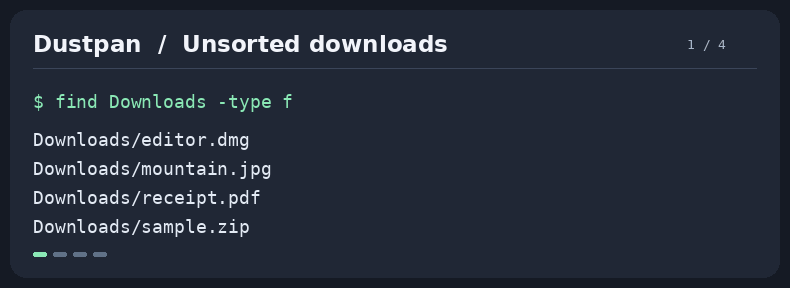

<div align="center">


<p>
  
  
  <a href="https://github.com/nsawill1405/dustpan/actions/workflows/ci.yml"></a>
  <a href="LICENSE"></a>
</p>

<p><a href="#start-here">Start here</a> · <a href="#default-rules">Default rules</a> · <a href="#undo-and-safety">Undo and safety</a> · <a href="#development">Development</a> · <a href="#license">License</a></p>

</div>

Dustpan tidies your Mac’s Downloads folder with rules you control. Preview first, sort once, or let it run at login. It doesn’t delete or overwrite your files, and you can undo a batch.



## Start here

Dustpan supports macOS 12 or later on Apple Silicon and Intel.

Download the matching archive from [GitHub Releases](https://github.com/nsawill1405/dustpan/releases) (`arm64` for Apple Silicon, `amd64` for Intel), or build it with [Go 1.26](https://go.dev/dl/):

```sh
git clone https://github.com/nsawill1405/dustpan.git
cd dustpan
go build -o dustpan .
```

Run these commands from the folder containing the binary (or use `dustpan` if it’s on your PATH):

```sh
./dustpan plan          # preview; writes neither files nor config
./dustpan run --once    # apply the plan to eligible files
./dustpan undo         # restore the most recent batch
```

`./dustpan run` watches in the foreground. To start watching now and at each login, run `./dustpan install` from Terminal in your Mac desktop session. **This starts sorting immediately.** `./dustpan status` shows the agent and undo history; `./dustpan uninstall` stops the agent and keeps your rules, history, and downloads.

If macOS denies Downloads access, check **System Settings → Privacy & Security → Files and Folders**. The login agent runs the copy at `~/Library/Application Support/Dustpan/bin/dustpan`, separately from Terminal. If needed, grant that copy access or use foreground mode from a Terminal that already has access. Watcher messages are in `watch.log` and `watch-error.log` in the Dustpan support folder.

## Default rules

| Files | Destination |
| --- | --- |
| Images | `Downloads/Images` |
| PDFs and office documents | `Downloads/Documents` |
| Archives | `Downloads/Archives` |
| DMG and PKG installer files | `Downloads/Installers` |
| Untouched for 30 days | `Downloads/Old/YYYY-MM`, before extension rules |
| Over 1 GB | Flagged and left in place |

Only regular files directly in Downloads are considered. Dustpan skips hidden files, symlinks, folders, and common partial downloads (such as `.crdownload`, `.part`, and `.download`). A file must be quiet for five minutes by default. Dustpan uses modification and access times, so it can’t always detect files left open in other apps or reads the filesystem doesn’t record. Unknown extensions stay put unless they age out.

Edit `~/.config/dustpan/rules.toml`. `install` writes the defaults only if the file is missing; to customize before installing, run:

```sh
mkdir -p ~/.config/dustpan
(set -C; ./dustpan rules > ~/.config/dustpan/rules.toml)
```

Unspecified settings keep their defaults. If you supply any `[[rules]]`, that list replaces the default extension rules. Folders must be relative to Downloads; use `age_days = 0` or `large_bytes = 0` to disable those rules. The watcher reloads the file on its next pass.

```toml
quiet_for = "10m"
age_days = 0
large_bytes = 1000000000

[[rules]]
extensions = ["pdf", "docx"]
folder = "Reading/Documents"
```

Use `--downloads DIR` to try Dustpan on a scratch folder. Use the same folder for `run`, `status`, and `undo`; `--config FILE` and `--state DIR` can also override the defaults.

## Undo and safety

- Each group of moves from one pass is a batch. `undo` restores the latest batch with moves left to undo; `undo --all-today` restores today’s batches by local time.
- When a name is taken, Dustpan adds ` (2)` and counts up. Both moves and restores use a filesystem operation that refuses to overwrite an existing path.
- If a filed copy changed or disappeared, Dustpan reports it and leaves it alone. Restored files stay put until they’re renamed or changed.
- Moves stay on the same filesystem. Dustpan refuses symlinked destination folders and writes its JSON journal before moving anything. Don’t remove the journal if you want to undo later. Undo leaves any now-empty category folders in place.

## Development

Run `go test -race ./...` and `go vet ./...`. CI tests on macOS and Linux; version tags build archives and checksums for both Mac architectures. The login agent is macOS-only.

## License

[MIT](LICENSE) © William North. Issues and pull requests are welcome.

---

<div align="center">

<sub>Made by <a href="https://github.com/nsawill1405">William North</a> · <a href="https://nsawill.co.uk">nsawill.co.uk</a></sub>


</div>
